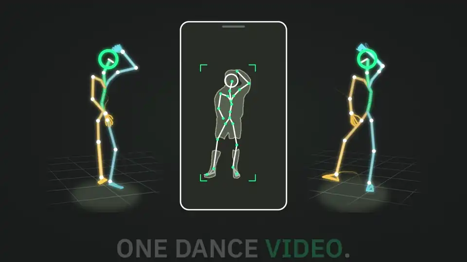
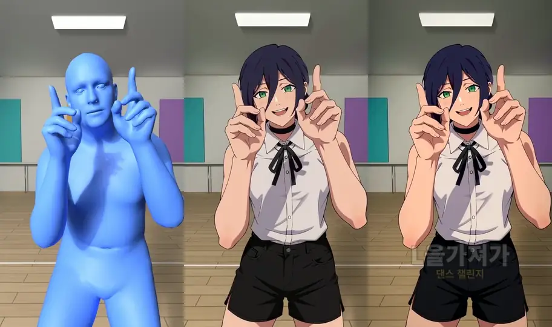
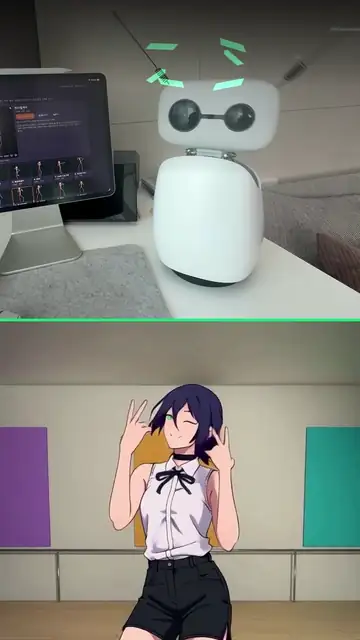
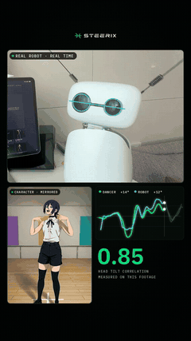
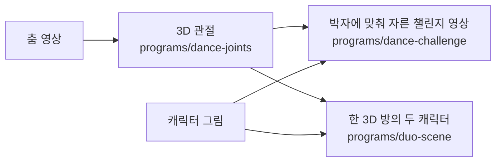

# 댄스 3D — 춤 영상 하나로 캐릭터 영상 만들기

1. **영상 → 3D 관절.** 춤 영상 속 한 사람의 움직임을 3D 관절(SMPL-X 몸, 손, 카메라 길)로 바꿉니다. 편집으로 끊긴 곳, 좌우가 뒤집힌 영상, 가짜 바닥, 화면 밖으로 나간 다리를 검사합니다.
2. **관절 → 3D 무대.** 움직임을 정해진 3D 방에 놓고, 색칠한 인형으로 어느 방향에서든 찍습니다(Blender).
3. **3D 무대 → 캐릭터 영상.** 영상 모델(기본 SCAIL-2, 고르면 MiniMax H3)이 그림 한 장의 캐릭터를 인형 위에 입히고, 장면을 박자에 맞춰 잘라 세로 챌린지 영상으로 만듭니다.


[English (README.md)](README.md) · [쓰는 모든 것의 사용 조건 (THIRD_PARTY.md)](THIRD_PARTY.md)

## 결과

아래 그림은 소리 없이 저절로 재생됩니다. 캐릭터 영상은 **MiniMax H3**로 만들었습니다.

### 전체 방법을 한 편으로 (2분 21초)



춤 영상 하나를 3D 관절(몸, 손, 카메라가 움직인 길)로 바꿉니다. 관절을 3D 방에 놓으면 어느 카메라로든 찍을 수 있습니다. 영상 모델이 그림 한 장의 캐릭터를 그 3D 몸 위에 입히고, 같은 관절로 실제 책상 로봇도 움직입니다.

### 명령 한 번으로 만든 챌린지 영상

| 완성된 챌린지 영상 | 같은 영상과 그 3D 화면 |
| --- | --- |
|  |  |

`./run.sh challenge` 는 춤 하나의 관절과 캐릭터 그림 한 장을 받습니다. 음악의 박자를 찾고, 어느 카메라가 언제 찍을지(앞, 왼쪽, 오른쪽, 뒤, 가까이) 정하고, 카메라마다 파란 인형을 그린 뒤, 영상 모델이 그 위에 캐릭터를 입힙니다. 장면마다 검사하고(방이 그대로인지, 인형이 남지 않았는지, 3D 몸과 박자가 맞는지) 통과하지 못한 장면은 다시 만든 다음, 박자에 맞춰 이어 붙입니다. 손으로 고치는 단계는 없습니다. 오른쪽 그림의 파란 인형이 각 장면을 입힌 3D 몸입니다.

### 짧은 영상 (37초)과 로봇

| 짧은 영상 | 같은 관절 → 실제 로봇 |
| --- | --- |
|  |  |

관절은 캐릭터에만 쓰이지 않습니다. 같은 춤의 머리 움직임으로 책상 로봇을 실시간으로 움직였습니다.

원래 크기 영상(소리 없음), 챌린지 영상, 한국어 기술 문서: 릴리스 **[dance3d-2026-11-16](../../releases/tag/dance3d-2026-11-16)**.

## 캐릭터를 입히는 여러 가지 방법

관절과 3D 무대는 어느 경우나 같고, 마지막 단계인 영상 모델만 바뀝니다.

| 영상 모델 | 그래픽카드 메모리 | 결과 | 사용 조건 |
| --- | --- | --- | --- |
| **MiniMax H3** (`--backend h3`) | 저희는 32 GB 카드로 돌렸고, 더 작은 카드는 해 보지 않았습니다 | 위 영상을 만든 모델. 캐릭터 그림(얼굴, 머리, 표정)을 가장 잘 따릅니다. 두 사람 춤은 이 모델로만 됩니다. | MiniMax H3 Community License, 지역 제한은 [아래](#minimax-h3-선택) 참고 |
| **SCAIL-2** (`--backend scail`, 설치 기본값) | 8 / 12 / 16 / 24 GB 단계 | 작은 카드에서 돕니다(12 GB 단계에서 최대 10 GB 사용을 쟀습니다). 동작, 방, 옷은 유지되지만, 저희가 돌려 본 결과로는 H3보다 그림을 덜 따릅니다: 표정이 밋밋하고 선이 흐리며, 그림에 없는 부분(뒷머리, 작은 장신구)을 지어낼 때가 있습니다. | MIT |
| 다른 모델 | — | 영상 단계는 인형 영상, 마스크, 참고 그림을 ComfyUI로 넘기는 구조라 다른 영상 변환 모델로 바꿔 넣을 수 있습니다(`programs/duo-scene/solo_run.py`). 제공하지는 않습니다. | — |

## 필요한 것

| | 필요 | 시험한 컴퓨터 |
| --- | --- | --- |
| 그래픽카드 | NVIDIA, 8 GB 이상 (아래 단계 표) | RTX 5090, 32 GB |
| NVIDIA 드라이버 | 580 이상 (윈도우에서는 윈도우용 드라이버) | 615.71.09 |
| 메모리(RAM) | 32 GB 권장 (30 GB 보다 적으면 설치 프로그램이 경고합니다) | 64 GB |
| 디스크 | 챌린지 영상만: 40~49 GB (단계에 따라), `--joints` 까지: 53~63 GB; 끝난 실행 하나마다 3~6 GB 더 | |
| 운영체제 | 우분투 22.04 또는 24.04 (x86_64), 또는 윈도우 10/11 + WSL2(우분투) | 우분투 24.04.4 |
| 계정 | [smpl-x.is.tue.mpg.de](https://smpl-x.is.tue.mpg.de) 무료 등록(SMPL-X 몸 모델), [SAM 3](https://huggingface.co/facebook/sam3) 사용 허가를 받은 Hugging Face 계정 | |

설치 프로그램은 그래픽카드 메모리에 맞춰 SCAIL-2 모델 파일을 고릅니다(`--vram auto`). 직접 정하려면 `--vram 8|12|16|24`:

| 단계 | SCAIL-2 파일 | 받는 크기 | 영상 크기 | 글 해석(텍스트 인코더)을 돌리는 곳 |
| --- | --- | --- | --- | --- |
| 8 GB | GGUF Q3_K_M | 8.1 GB | 480 × 832 | CPU |
| 12 GB | GGUF Q4_K_M | 10.9 GB | 512 × 896 | CPU |
| 16 GB | GGUF Q6_K | 13.8 GB | 576 × 1024 | 그래픽카드 |
| 24 GB 이상 | fp8 (safetensors) | 17.7 GB | 704 × 1248 | 그래픽카드 |

## 설치

### 시작하기 전에 (한 번만)

1. **SMPL-X 몸 모델**: [smpl-x.is.tue.mpg.de](https://smpl-x.is.tue.mpg.de/register.php) 에 등록하고 사용 조건에 동의한 뒤, **SMPL-X v1.1 (NPZ+PKL)** (`models_smplx_v1_1.zip`) 을 `~/Downloads/` 에 받습니다.
2. **MANO 손 모델** (`--joints` 때만): [mano.is.tue.mpg.de](https://mano.is.tue.mpg.de/register.php) 에 등록하고 `mano_v1_2.zip` 을 `~/Downloads/` 에 받습니다.
3. **SAM 3** (`--joints` 때는 **SAM 3D Body** 도) 는 허가를 받아야 받을 수 있습니다. Hugging Face 에 로그인해 [facebook/sam3](https://huggingface.co/facebook/sam3) (와 [facebook/sam-3d-body-dinov3](https://huggingface.co/facebook/sam-3d-body-dinov3)) 에서 사용을 요청하고, 허가가 날 때까지 기다립니다. 그다음 [huggingface.co/settings/tokens](https://huggingface.co/settings/tokens) 에서 읽기용 토큰을 만듭니다. 설치 프로그램은 이 토큰을 huggingface.co 에만 보냅니다.

설치 프로그램은 두 zip 파일을 `.dance3d/downloads/` 와 저장소 폴더에서도 찾습니다.

### 리눅스 (우분투 22.04 / 24.04)

```bash
sudo apt-get update && sudo apt-get install -y git curl ca-certificates xz-utils ffmpeg build-essential \
  fonts-noto-cjk libvulkan1 libx11-6 libxrender1 libxfixes3 libxi6 libxkbcommon0 libegl1 libgl1
git clone https://github.com/kraizer-ai/dance3d.git
cd dance3d
install/install.sh --check                   # 준비 상태만 검사: 드라이버, 패키지, 디스크, 메모리
export HF_TOKEN=<Hugging Face 읽기용 토큰>
install/install.sh --joints                  # 영상 → 관절 → 챌린지 영상 (--joints 없이: 이미 가진 관절로 챌린지 단계만)
```

설치 프로그램은 `sudo` 를 쓰지 않습니다. 시스템 패키지가 빠져 있으면 멈추고, 실행할 `apt-get` 한 줄을 보여 줍니다. 끝났을 때 아직 빠진 것(zip 파일, Hugging Face 허가)이 있으면 무엇인지 알려 줍니다. 그것을 채우고 같은 명령을 다시 실행하면, 멈춘 곳부터 이어 하고 끝난 일은 건너뜁니다.

### 윈도우 10 / 11 (WSL2)

1. NVIDIA 드라이버 580 이상을 **윈도우에** 설치합니다(WSL 안에 설치하지 않습니다).
2. PowerShell 에서:
   ```powershell
   wsl --install -d Ubuntu-24.04
   ```
   PC 를 다시 시작하고, 시작 메뉴에서 "Ubuntu 24.04" 를 열어 사용자 이름과 비밀번호를 정합니다.
3. WSL 은 기본으로 PC 메모리의 절반만 씁니다. PC 메모리가 64 GB 보다 적으면 `%UserProfile%\.wslconfig` 파일을 아래 내용으로 만들고, PowerShell 에서 `wsl --shutdown` 을 실행한 뒤 우분투를 다시 엽니다.
   ```ini
   [wsl2]
   memory=28GB
   ```
4. 우분투 창에서 그래픽카드를 확인하고, 윈도우 브라우저로 받은 zip 파일을 리눅스 홈 폴더로 복사합니다.
   ```bash
   nvidia-smi
   mkdir -p ~/Downloads
   cp /mnt/c/Users/<윈도우 사용자 이름>/Downloads/models_smplx_v1_1.zip ~/Downloads/
   cd ~
   ```
5. 같은 창에서 **위 리눅스 명령**을 실행합니다. 저장소는 리눅스 홈 폴더에 둡니다. 윈도우 드라이브(`/mnt/c/...`)는 느리고 리눅스 권한이 사라져서, 설치 프로그램이 그곳의 저장소를 거부합니다.

### 사용 조건(라이선스)

모델의 사용 조건은 하나마다 한 번씩 보여 주고, `yes` 를 입력해야 받습니다. 답은 `.dance3d/licences-accepted.json` 에 남습니다. 여러 모델이 **비상업 용도만** 허락합니다([THIRD_PARTY.md](THIRD_PARTY.md)). 입력창이 없는 곳(스크립트)에서는 조건을 읽은 뒤 이름으로 동의합니다.

```bash
install/install.sh --accept mit --accept apache-2.0 --accept sam3 --accept insightface --accept smpl-x
install/install.sh --joints --accept mit --accept apache-2.0 --accept sam3 --accept insightface --accept smpl-x \
  --accept exmr --accept sapiens2 --accept sam-3d-body --accept dinov3 --accept agpl-3.0 --accept mano
```

`install/get_models.py --list` 는 모델 파일마다 출처, 크기, 사용 조건 이름을 보여 줍니다.

### 옵션

| 옵션 | 내용 |
| --- | --- |
| `--challenge` (기본) | Blender, ComfyUI + SCAIL-2, 챌린지에 필요한 동작 도구, SAM 3, 얼굴 모델, SMPL-X |
| `--joints` | 영상 → 3D 관절도: ExMR, SAM 3D Body, HaMeR, Sapiens2, YOLO11, MoGe-2, MANO, yt-dlp |
| `--all` | `--joints` + 그림 설명 모델(Qwen2.5-VL, 16.6 GB) + SCAIL-2 조명 LoRA (H3 는 들어 있지 않음) |
| `--h3` | MiniMax H3 도 (42.2 GB, 선택, 아래 경고를 읽어 주세요) |
| `--vram 8\|12\|16\|24\|auto` | SCAIL-2 단계 (기본: 그래픽카드를 보고 정함) |
| `--models-from 폴더` | 이미 가진 모델 파일을 받지 않고 연결합니다(이름·크기·SHA-256 이 같은 파일). `--copy` 를 붙이면 복사 |
| `--runs-dir 폴더`, `--results-dir 폴더` | 실행이 일하는 곳(기본 `.dance3d/runs`)과 결과를 두는 곳(기본 `results/`) |
| `--check` | 준비 상태만 검사 |

모든 것이 저장소 안의 `.dance3d/` (또는 `$DANCE3D_HOME`)에 들어갑니다. 프로그램은 설치 프로그램이 쓴 `config.local.json` 을 읽습니다. [`config.example.json`](config.example.json) 에 항목마다 설명이 있습니다. `install/get_models.py --check` 는 어떤 모델 파일이 있는지 보여 줍니다.

### 걸리는 시간, 받는 양, 디스크

시험한 컴퓨터(우분투 24.04, RTX 5090, 메모리 64 GB)에서, 새로 받은 저장소와 비어 있는 패키지 보관 폴더로 잰 값입니다. `install/install.sh --joints` 가 **6분 39초** 걸렸습니다. 여기에는 프로그램 약 8.5 GB 받기(파이썬 패키지, Blender 4.5, 프로그램 원본), 파이썬 환경 네 개 만들기, 모델 파일 45.5 GB 의 SHA-256 검사(이것이 약 3분 30초)가 들어 있습니다. 모델 파일은 이 컴퓨터에 있던 것을 연결했으므로, **모델을 받는 시간은 들어 있지 않습니다.** 참고로 시험 다운로드는 초당 32~41 MB 였습니다. 이 빠르기면 23~46 GB 가 12~22분, 100 Mbit/s 회선이면 35~60분 걸립니다. 모두 설치된 뒤 다시 실행하면 약 20초 걸립니다.

| GB | 8 GB 단계 | 12 GB 단계 | 16 GB 단계 | 24 GB 단계 |
| --- | --- | --- | --- | --- |
| 받는 양, `install/install.sh` | 31 | 34 | 37 | 41 |
| 설치 뒤 디스크 | 40 | 42 | 45 | 49 |
| 받는 양, `install/install.sh --joints` | 44 | 47 | 50 | 54 |
| 설치 뒤 디스크 | 53 | 56 | 59 | 63 |

프로그램이 디스크 17 GB 를 씁니다(동작 환경 7.6 GB, ComfyUI 환경 6.3 GB, Blender 1.2 GB, 나머지는 작음). 나머지는 모델 파일입니다. `--all` 은 17.8 GB, `--h3` 는 42.2 GB 를 더 받고 그만큼 디스크를 더 씁니다. SMPL-X zip(약 0.8 GB)과 MANO zip 은 직접 받습니다. 시험한 컴퓨터에서 끝난 실행은 하나에 3~6 GB 를 남겼습니다. 실행 중 가장 많이 쓰는 양은 재지 않았습니다.

## 실행

```bash
./run.sh check                                                     # 무엇이 빠졌고 어떻게 구하는지
./run.sh joints my_dance.mp4                                       # 영상 → 3D 관절 (install/install.sh --joints 필요)
./run.sh challenge --joints 'results/<joints run>/01_my_dance' --character my_character.png --music song.m4a
./run.sh challenge --joints 'results/<joints run>/01_my_dance' --character my_character.png --seconds 5   # 빨리 해 보기
./run.sh duo --video two_dancers.mp4 --character left.png --character right.png   # --joints --h3 필요
```

윈도우에서는 같은 명령을 우분투 창에서 실행합니다. 윈도우의 파일은 `/mnt/c/Users/<이름>/...` 에 있습니다.

- 이 저장소에는 관절 파일이 들어 있지 않습니다. 먼저 `./run.sh joints` 로 자기 춤 영상에서 관절을 만들고(`--joints` 로 설치), 그 영상의 결과 폴더를 `challenge` 에 넘깁니다.
- 챌린지 영상의 음악은 `--music` 으로 줍니다. 없으면 소리 없는 영상이 됩니다(이 저장소에는 춤 영상이 없습니다).
- `challenge` 는 SCAIL-2 를 씁니다. `--backend h3` 를 주면 MiniMax H3 를 씁니다(설치 때 `--h3` 필요). `--vram` 을 주면 더 작은 그래픽카드에서처럼 돌아갑니다.
- 두 사람 프로그램(`duo`)은 아직 MiniMax H3 로만 돌아갑니다. 그래서 `install/install.sh --joints --h3` 가 필요하고, 아래 H3 사용 조건이 적용됩니다.
- 결과는 `results/` 에 생깁니다. 실행마다 `.dance3d/runs/` 아래 자기 폴더에서 일합니다. 멈춘 실행은 `--job <실행 폴더>` 로 이어 갑니다. 다 쓴 실행 폴더는 지우세요.
- 처음 `joints` 를 실행하면 DINOv3 의 코드를 GitHub 에서 받습니다(SAM 3D Body 가 `torch.hub` 로 불러옵니다).
- 명령 뒤에 `--help` 를 붙이면 그 프로그램의 모든 옵션이 나옵니다.
- 프로그램의 웹 화면(포트 7863~7865)은 만든 컴퓨터에서 백그라운드 서비스로 켜집니다. 그 설정은 이 설치에 들어 있지 않고 다른 컴퓨터에서 시험하지 않았습니다. 그래서 `run.sh` 에는 화면을 켜는 명령이 없습니다.

## 문제가 생기면

설치 프로그램을 시험할 때 실제로 나온 안내와, 그때 할 일입니다.

| 안내 (앞부분) | 할 일 |
| --- | --- |
| `System packages are missing. Run this (it needs your password), then this installer again:` | 보여 주는 `sudo apt-get …` 한 줄을 실행하고, 설치 프로그램을 다시 실행합니다. |
| `The NVIDIA driver … is older than 580` | NVIDIA 드라이버를 새로 설치합니다(WSL2 에서는 윈도우 쪽 드라이버). |
| `The card has … MiB; SCAIL-2 needs at least 8 GB` | 8 GB 이상인 그래픽카드가 필요합니다. |
| `nvidia-smi found no graphics card` | `nvidia-smi` 가 그래픽카드를 보여 줄 때까지 NVIDIA 드라이버를 설치합니다(WSL2 에서는 윈도우에). |
| `SMPL-X needs a registration: …` | `models_smplx_v1_1.zip` 을 `~/Downloads/` 에 넣고("시작하기 전에") 설치 프로그램을 다시 실행합니다. |
| `facebook/sam3 is gated on Hugging Face. …` | 모델 페이지에서 사용을 요청하고, 허가가 나면 `export HF_TOKEN=…` 뒤 설치 프로그램을 다시 실행합니다. |
| `Not accepted: … Read it, then run again with --accept <id>` | 입력창 없이 실행된 경우입니다. 사용 조건을 읽고 `--accept <id>` 를 붙입니다. |
| 받기가 멈춤 (인터넷 끊김, Ctrl-C) | 같은 명령을 다시 실행하면 멈춘 곳부터 이어 받습니다(중간에 멈춘 받기로 시험함). |
| `STOPPED: no config at …` | 먼저 `install/install.sh` 를 실행합니다. |
| `./run.sh check` 에 `MISS` 가 나옴 | 같은 옵션으로 설치 프로그램을 다시 실행합니다. 그 줄에 빠진 파일이나 설정이 적혀 있습니다. |

## MiniMax H3 (선택)

> [!IMPORTANT]
> 한국, 미국, 유럽연합, 영국에서 MiniMax H3 를 쓰거나 그 결과물을 배포·게시하려면 MiniMax 의 별도 허가가 필요합니다. [MiniMax H3 Community License, I.5 및 V.4 항](https://huggingface.co/MiniMaxAI/MiniMax-H3/blob/main/LICENSE)
>
> 이 지역에서 비상업 연구를 한다면, 내 컴퓨터에서 쓰고 결과를 공개하는 것을 허락하는 다른 영상 생성 모델을 쓰기를 권합니다.

H3 는 따로 요청하지 않으면 설치하지 않습니다(`install/install.sh --h3`). 요청하면 설치 프로그램이 지역 조항을 한 번 더 확인받습니다(입력창이 없으면 `--accept minimax-h3`). 챌린지 영상은 기본으로 SCAIL-2 를 쓰고, H3 가 없어도 됩니다.

## 시험하지 않은 것

- 윈도우 + WSL2, 우분투 22.04: 우분투 24.04.4 만 썼습니다.
- RTX 5090(32 GB) 이 아닌 그래픽카드. 8, 12, 16 GB 단계는 돌려 보지 않았습니다. 그 SCAIL-2 파일은 이 설치 프로그램 밖에서 한 번 받아 보았고, 설치 프로그램이 기대하는 SHA-256 과 같습니다.
- 모든 모델 파일을 인터넷에서 받는 것. 시험 설치에서는 SHA-256 이 같은, 이 컴퓨터에 있던 모델 파일 45.5 GB 를 연결했습니다. 실제 받기는 ExMR, YOLO11, HaMeR, MoGe-2, 얼굴 모델, SAM 3D Body 의 MHR 모델(모두 6 GB)로 시험했고, 중간에 멈춘 받기 이어 하기와 토큰으로 허가된 파일 받기도 시험했습니다.
- 등록해서 받는 파일 그 자체: SMPL-X 와 MANO 는 같은 모델 파일로 공식 zip 과 같은 구조의 zip 을 만들어 시험했고, 두 사이트에서 받은 zip 으로는 시험하지 않았습니다.
- 이 저장소를 새로 설치한 상태에서 처음부터 끝까지(춤 관절 → 챌린지 영상) 돌리기.
- 만든 컴퓨터가 아닌 곳에서 프로그램의 웹 화면.

## 어떻게 움직이나



1. **영상 → 관절.** 한 사람을 따라가며(SAM 3, YOLO11) 몸·손·카메라를 3D 로 되살립니다(ExMR + SAM 3D Body, Sapiens2, HaMeR; 장면의 모양은 MoGe-2). 편집으로 끊긴 곳, 좌우 뒤집힘, 가짜 바닥, 화면 밖 다리를 검사합니다.
2. **관절 → 3D 몸.** 움직임을 정해진 3D 방에 놓고, 색칠한 인형을 어느 카메라로든(앞, 왼쪽, 오른쪽, 뒤, 한 바퀴, 원본 카메라) Blender 로 찍습니다.
3. **3D 몸 → 영상.** 영상 모델(챌린지 영상은 SCAIL-2, 고르면 MiniMax H3; 두 사람은 H3)이 그림의 캐릭터를 인형 위에 짧은 조각씩 입히고, 조각마다 검사해 틀리면 다시 만듭니다(방 유지, 맞는 머리와 옷, 남은 인형 없음, 안내 영상과 같은 박자). 끝으로 얼굴을 검사합니다(InsightFace).

## 저장소 구성

| 경로 | 내용 |
| --- | --- |
| `install/` | `install.sh`(설치), `get_models.py`(모델 표, 사용 조건, 받기, 검사), `write_config.py`, `pins/`(패키지의 정확한 버전) |
| `run.sh` | 프로그램 실행 입구 하나: `check`, `joints`, `challenge`, `duo` |
| `config.example.json` | 프로그램이 읽는 설정의 모든 항목 (`config.local.json` 은 설치 프로그램이 씀) |
| `programs/dance-joints/` | 춤 영상 → 영상마다 한 사람의 3D 관절 (`results.npz`, BVH, AMASS) |
| `programs/dance-challenge/` | 관절 + 캐릭터 그림 한 장 → 앞·왼쪽·오른쪽·뒤 카메라를 박자에 맞춰 자른 세로 챌린지 영상 |
| `programs/duo-scene/` | 한 영상의 두 사람 → 한 3D 방의 두 캐릭터 |
| `THIRD_PARTY.md` | 쓰는 모든 프로그램과 모델의 사용 조건, 상업 사용 가능 여부, 출처 |
| `promo/` | 홍보 영상(2026-11-16)을 만든 스크립트 |
| `docs/tech-document/` | 한국어 기술 문서 (PDF 4쪽), HTML 원본과 만드는 스크립트 |
| `single-dancer-free-camera/` | 첫 단계 (2026-11-10 ~ 11-12): 한 사람, 카메라를 고칠 수 있는 3D; 따로 README 가 있음 |

프로그램 폴더마다 한국어 안내(`README.md`, `사용법.txt`)에 단계와 검사가 적혀 있습니다.

## 참고

- 모델 파일, 참고 그림, 비밀번호·토큰은 들어 있지 않습니다. 모델은 설치 프로그램이 원래 출처에서 받습니다.

## 사용 조건

**비상업 연구용**입니다. 저희가 쓴 것(프로그램, 스크립트, 문서)은 [CC BY-NC 4.0](LICENSE)을 따릅니다. 설치 프로그램이 받는 도구와 모델은 각자의 사용 조건을 그대로 따르며, 여러 개가 비상업 전용입니다: [THIRD_PARTY.md](THIRD_PARTY.md). 예시 그림과 영상 속 캐릭터의 권리는 각 권리자에게 있습니다.
