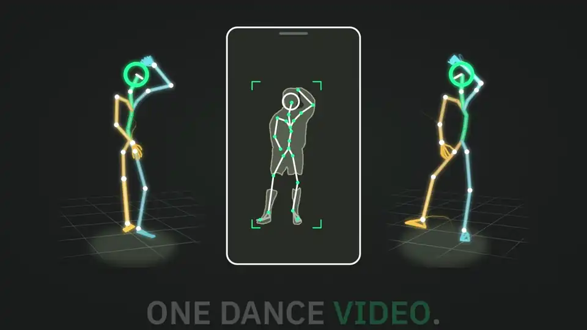
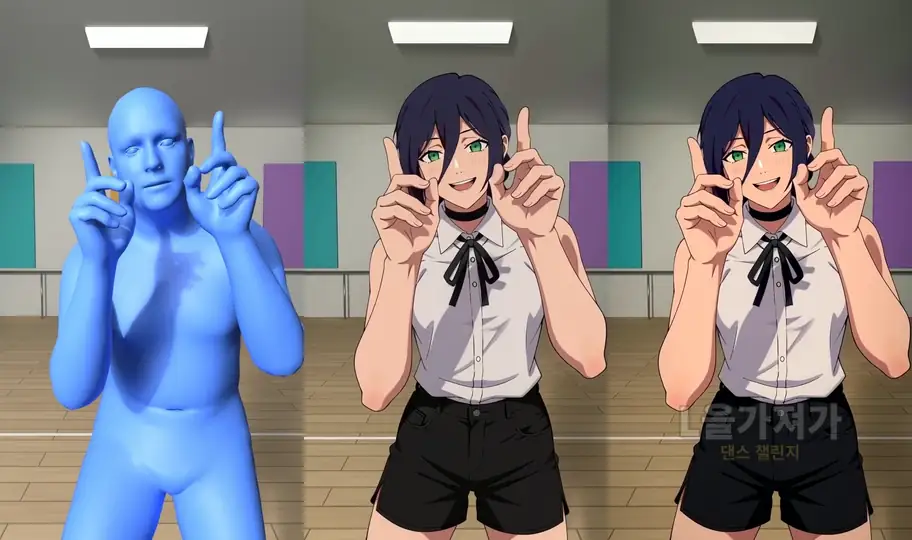
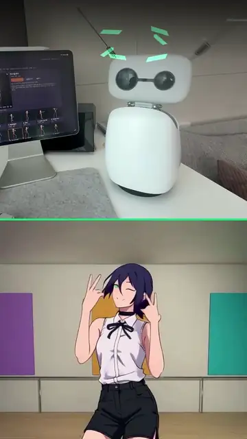
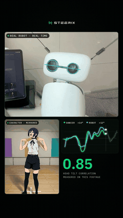
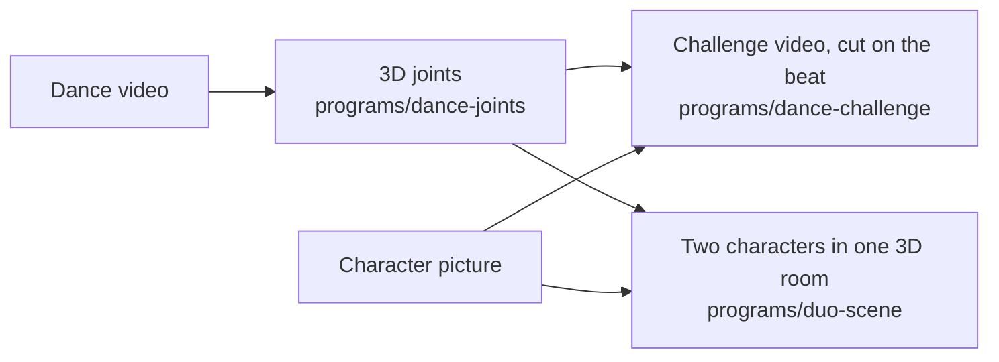

# Dance 3D — one dance video in, characters out

1. **Video → 3D joints.** One dancer of a dance video becomes 3D joints (SMPL-X body, hands, camera path), with checks for edit cuts, mirrored videos, fake floors and legs out of the picture.
2. **Joints → 3D studio.** The motion is placed in a fixed 3D room and rendered as a coloured mannequin from any camera (Blender).
3. **3D studio → character video.** A video model (SCAIL-2 by default; MiniMax H3 optional) paints the character of one picture over the mannequin, and the shots are cut on the beat into a vertical challenge video.


[한국어 안내 (README.ko.md)](README.ko.md) · [Licences of everything used (THIRD_PARTY.md)](THIRD_PARTY.md)

## Results

The pictures below play by themselves, without sound. The character videos were made with **MiniMax H3**.

### The whole method in one film (2:21)



One dance video is turned into 3D joints (body, hands and the camera's path). The joints are placed in a 3D room, where any camera can film them. A video model paints a character from one picture over that 3D body, and the same joints also move a real desk robot.

### A challenge video, made by one command

| Finished challenge video | The same video next to its 3D scene |
| --- | --- |
|  |  |

`./run.sh challenge` takes the joints of one dance and one character picture. It finds the beat of the music, plans which camera films when (front, left, right, back, close), renders the blue mannequin from each camera, lets the video model paint the character over it, checks every shot (room kept, no mannequin left, in step with the 3D body) and remakes a failed shot, then cuts the shots on the beat. Nothing is adjusted by hand. On the right, the blue mannequin is the 3D body that each shot was painted from.

### Short film (0:37) and the robot

| Short film | Same joints → real robot |
| --- | --- |
|  |  |

The joints are not tied to a character: here the head motion of the same dance drives a desk robot in real time.

Full-size films (no sound), the challenge videos and the Korean technical document: release **[dance3d-2026-11-16](../../releases/tag/dance3d-2026-11-16)**.

## Several ways to paint the character

The joints and the 3D studio are the same in every case; only the last step, the video model, changes.

| Video model | Card memory | What to expect | Licence |
| --- | --- | --- | --- |
| **MiniMax H3** (`--backend h3`) | 32 GB card used here; smaller cards not tried | Made the videos above. Follows the character picture most closely (face, hair, expression). Also the only one wired in for two dancers. | MiniMax H3 Community License; territory limits, see [below](#minimax-h3-optional) |
| **SCAIL-2** (`--backend scail`, the installer's default) | 8 / 12 / 16 / 24 GB tiers | Runs on small cards (measured: 10 GB peak on the 12 GB tier). Motion, room and outfit hold; in our runs it was less faithful to the picture than H3: flatter expression, softer lines, and it sometimes invents what the picture does not show (hair from behind, small accessories). | MIT |
| Another model | — | The video step takes a mannequin video, a mask and reference pictures through ComfyUI, so another video-to-video model can be put in its place (`programs/duo-scene/solo_run.py`). Not provided. | — |

## Requirements

| | Needed | Tested on |
| --- | --- | --- |
| Graphics card | NVIDIA, 8 GB or more (see the tiers below) | RTX 5090, 32 GB |
| NVIDIA driver | 580 or newer (on Windows: the Windows driver) | 615.71.09 |
| Memory (RAM) | 32 GB recommended (the installer warns below 30 GB) | 64 GB |
| Disk | 40–49 GB for the challenge video (by tier), 53–63 GB with `--joints`; each finished run keeps 3–6 GB more | |
| System | Ubuntu 22.04 or 24.04 (x86_64), or Windows 10/11 with WSL2 (Ubuntu) | Ubuntu 24.04.4 |
| Accounts | Free registration at [smpl-x.is.tue.mpg.de](https://smpl-x.is.tue.mpg.de) (SMPL-X body model); a Hugging Face account with access to [SAM 3](https://huggingface.co/facebook/sam3) | |

The installer picks the SCAIL-2 model file by the memory of the graphics card (`--vram auto`), or by `--vram 8|12|16|24`:

| Tier | SCAIL-2 file | Download | Video size | Text encoder runs on |
| --- | --- | --- | --- | --- |
| 8 GB | GGUF Q3_K_M | 8.1 GB | 480 × 832 | CPU |
| 12 GB | GGUF Q4_K_M | 10.9 GB | 512 × 896 | CPU |
| 16 GB | GGUF Q6_K | 13.8 GB | 576 × 1024 | graphics card |
| 24 GB and more | fp8 (safetensors) | 17.7 GB | 704 × 1248 | graphics card |

## Install

### Before you start (once)

1. **SMPL-X body model**: register at [smpl-x.is.tue.mpg.de](https://smpl-x.is.tue.mpg.de/register.php), accept the licence, and download **SMPL-X v1.1 (NPZ+PKL)** (`models_smplx_v1_1.zip`) into `~/Downloads/`.
2. **MANO hand model** (only for `--joints`): register at [mano.is.tue.mpg.de](https://mano.is.tue.mpg.de/register.php) and download `mano_v1_2.zip` into `~/Downloads/`.
3. **SAM 3** (and **SAM 3D Body** for `--joints`) are gated: log in at Hugging Face, open [facebook/sam3](https://huggingface.co/facebook/sam3) (and [facebook/sam-3d-body-dinov3](https://huggingface.co/facebook/sam-3d-body-dinov3)), request access and wait until it is granted. Then make a token with read access at [huggingface.co/settings/tokens](https://huggingface.co/settings/tokens). The installer sends it only to huggingface.co.

The installer also looks for the two zip files in `.dance3d/downloads/` and in the repository folder.

### Linux (Ubuntu 22.04 / 24.04)

```bash
sudo apt-get update && sudo apt-get install -y git curl ca-certificates xz-utils ffmpeg build-essential \
  fonts-noto-cjk libvulkan1 libx11-6 libxrender1 libxfixes3 libxi6 libxkbcommon0 libegl1 libgl1
git clone https://github.com/kraizer-ai/dance3d.git
cd dance3d
install/install.sh --check                   # prerequisites only: driver, packages, disk, memory
export HF_TOKEN=<your Hugging Face read token>
install/install.sh --joints                  # video -> joints -> challenge video (without --joints: only the challenge step, for joints you already have)
```

The installer itself never uses `sudo`: when a system package is missing it stops and prints the one `apt-get` line to run. When something is still missing at the end (a zip, the Hugging Face access), it says what; fix it and run the same command again. It goes on where it stopped and skips what is done.

### Windows 10 / 11 (WSL2)

1. Install the NVIDIA driver 580 or newer **on Windows** (not inside WSL).
2. In PowerShell:
   ```powershell
   wsl --install -d Ubuntu-24.04
   ```
   Restart the PC, open "Ubuntu 24.04" from the Start menu and choose a user name and password.
3. WSL gets half of the PC's memory by default. If the PC has less than 64 GB, give WSL more: create the file `%UserProfile%\.wslconfig` with these lines, then run `wsl --shutdown` in PowerShell and open Ubuntu again.
   ```ini
   [wsl2]
   memory=28GB
   ```
4. In the Ubuntu window, check the card, then copy the zips you downloaded with the Windows browser into the Linux home folder:
   ```bash
   nvidia-smi
   mkdir -p ~/Downloads
   cp /mnt/c/Users/<your Windows user name>/Downloads/models_smplx_v1_1.zip ~/Downloads/
   cd ~
   ```
5. Run the **Linux commands above** in the same window. Keep the repository in the Linux home folder: the installer refuses a repository on a Windows drive (`/mnt/c/...`), where files are slow and lose their Linux permissions.

### Licences

Each model licence is shown once and must be accepted by typing `yes`; the answers are kept in `.dance3d/licences-accepted.json`. Several of them allow **non-commercial use only** (see [THIRD_PARTY.md](THIRD_PARTY.md)). Without a terminal (a script), accept them by name after reading them:

```bash
install/install.sh --accept mit --accept apache-2.0 --accept sam3 --accept insightface --accept smpl-x
install/install.sh --joints --accept mit --accept apache-2.0 --accept sam3 --accept insightface --accept smpl-x \
  --accept exmr --accept sapiens2 --accept sam-3d-body --accept dinov3 --accept agpl-3.0 --accept mano
```

`install/get_models.py --list` shows every model file with its source, size and licence name.

### Options

| Option | What |
| --- | --- |
| `--challenge` (default) | Blender, ComfyUI with SCAIL-2, the motion tools the challenge needs, SAM 3, face models, SMPL-X |
| `--joints` | also video → 3D joints: ExMR, SAM 3D Body, HaMeR, Sapiens2, YOLO11, MoGe-2, MANO, yt-dlp |
| `--all` | `--joints` plus the picture describer (Qwen2.5-VL, 16.6 GB) and the SCAIL-2 relight LoRA (H3 is not included) |
| `--h3` | also MiniMax H3 (42.2 GB; optional; read the warning below) |
| `--vram 8\|12\|16\|24\|auto` | SCAIL-2 tier (default: from the card) |
| `--models-from DIR` | link model files you already have (same name, size and SHA-256) instead of downloading them; with `--copy`, copy them |
| `--runs-dir DIR`, `--results-dir DIR` | where runs work (default `.dance3d/runs`) and where results go (default `results/`) |
| `--check` | only check the prerequisites |

Everything goes into `.dance3d/` inside the repository (or into `$DANCE3D_HOME`). The programs read `config.local.json`, which the installer writes; [`config.example.json`](config.example.json) explains every key. `install/get_models.py --check` lists which model files are there.

### Time, downloads and disk

Measured on the test machine (Ubuntu 24.04, RTX 5090, 64 GB memory), in a fresh clone with an empty package cache: `install/install.sh --joints` took **6 min 39 s**. That includes downloading about 8.5 GB of programs (Python packages, Blender 4.5, the program sources), building four Python environments, and checking 45.5 GB of model files by SHA-256 (about 3½ minutes of the total). The model files were linked from local copies, so **the time to download them is not included**. As a guide: the test downloads ran at 32–41 MB/s, at which 23–46 GB take 12–22 minutes; on a 100 Mbit/s line they take 35–60 minutes. Running the installer again when everything is there takes about 20 seconds.

| GB | 8 GB tier | 12 GB tier | 16 GB tier | 24 GB tier |
| --- | --- | --- | --- | --- |
| Download, `install/install.sh` | 31 | 34 | 37 | 41 |
| Disk after the install | 40 | 42 | 45 | 49 |
| Download, `install/install.sh --joints` | 44 | 47 | 50 | 54 |
| Disk after the install | 53 | 56 | 59 | 63 |

Programs take 17 GB on disk (motion environment 7.6 GB, ComfyUI environment 6.3 GB, Blender 1.2 GB, the rest small); the rest is model files. `--all` adds 17.8 GB and `--h3` adds 42.2 GB, both for the download and on disk. You download the SMPL-X zip (about 0.8 GB) and the MANO zip yourself. Finished runs on the test machine kept 3–6 GB each; how much a run needs at its peak was not measured.

## Run

```bash
./run.sh check                                                     # what is missing and how to get it
./run.sh joints my_dance.mp4                                       # video -> 3D joints (needs install/install.sh --joints)
./run.sh challenge --joints 'results/<joints run>/01_my_dance' --character my_character.png --music song.m4a
./run.sh challenge --joints 'results/<joints run>/01_my_dance' --character my_character.png --seconds 5   # quick try
./run.sh duo --video two_dancers.mp4 --character left.png --character right.png   # needs --joints --h3
```

On Windows, run the same commands in the Ubuntu window; Windows files are under `/mnt/c/Users/<name>/...`.

- No joints are included in this repository: make them from your own dance video with `./run.sh joints` first (install with `--joints`), then give that video's result folder to `challenge`.
- The challenge video takes its music from `--music`. Without it the video has no sound (this repository has no dance videos).
- `challenge` uses SCAIL-2; `--backend h3` uses MiniMax H3 instead (needs `--h3` at install). `--vram` makes a run behave as on a smaller card.
- The two-dancer program (`duo`) works only with MiniMax H3 so far, so it needs `install/install.sh --joints --h3`, and the H3 licence (below) applies.
- Results go to `results/`; each run works in its own folder under `.dance3d/runs/`. A stopped run goes on with `--job <run folder>`; delete run folders you no longer need.
- The first `joints` run downloads the code of DINOv3 from GitHub (SAM 3D Body loads it through `torch.hub`).
- `--help` after a command lists all of its options.
- The programs' local web pages (ports 7863–7865) are started as background services on the machine they were made on. That setup is not part of this install and was not tested elsewhere, so `run.sh` has no page command.

## Troubleshooting

These are the messages the tests of the installer produced, and what to do about them.

| Message (beginning) | What to do |
| --- | --- |
| `System packages are missing. Run this (it needs your password), then this installer again:` | Run the `sudo apt-get …` line it prints, then the installer again. |
| `The NVIDIA driver … is older than 580` | Update the NVIDIA driver (in WSL2: the driver on Windows). |
| `The card has … MiB; SCAIL-2 needs at least 8 GB` | A card with 8 GB or more is needed. |
| `nvidia-smi found no graphics card` | Install the NVIDIA driver (in WSL2: on Windows) until `nvidia-smi` shows the card. |
| `SMPL-X needs a registration: …` | Put `models_smplx_v1_1.zip` into `~/Downloads/` (see "Before you start") and run the installer again. |
| `facebook/sam3 is gated on Hugging Face. …` | Request access on the model page, wait until it is granted, `export HF_TOKEN=…`, run the installer again. |
| `Not accepted: … Read it, then run again with --accept <id>` | The installer ran without a terminal: read the licence, then add `--accept <id>`. |
| A download stopped (network, Ctrl-C) | Run the same command again: it continues where it stopped (tested with a download stopped halfway). |
| `STOPPED: no config at …` | Run `install/install.sh` first. |
| `./run.sh check` shows `MISS` | Run the installer again with the same options; the line names the missing file or setting. |

## MiniMax H3 (optional)

> [!IMPORTANT]
> Using MiniMax H3 or distributing or displaying its outputs in South Korea, the United States, the European Union, or the United Kingdom requires separate authorization from MiniMax. [MiniMax H3 Community License, Sections I.5 and V.4](https://huggingface.co/MiniMaxAI/MiniMax-H3/blob/main/LICENSE)
>
> For non-commercial research in these excluded regions, we recommend using a different video generation model whose license permits local use and publication of results.

H3 is not installed unless you ask for it (`install/install.sh --h3`), and then the installer asks you to confirm the territory clause (without a terminal: `--accept minimax-h3`). The challenge video uses SCAIL-2 by default and needs no H3.

## What was not tested

- Windows with WSL2, and Ubuntu 22.04: only Ubuntu 24.04.4 was used.
- Cards other than the RTX 5090 (32 GB). The 8, 12 and 16 GB tiers have not been run. Their SCAIL-2 files were downloaded once outside this installer and have the SHA-256 the installer expects.
- A complete download of all model files from the internet. The test install linked 45.5 GB of model files from local copies with the same SHA-256. Real downloads were tested for ExMR, YOLO11, HaMeR, MoGe-2, the face models and SAM 3D Body's MHR model (6 GB), including a stopped and continued download and a gated download with a token.
- The registration downloads themselves: the SMPL-X and MANO steps were tested with zip files in the official layout built from the same model files, not with zips from the two sites.
- A complete run (dance joints → challenge video) on a fresh install of this repository.
- The programs' local web pages outside the machine they were made on.

## How it works



1. **Video → joints.** One dancer is tracked (SAM 3, YOLO11); body, hands and the camera are recovered in 3D (ExMR with SAM 3D Body, Sapiens2, HaMeR; MoGe-2 for the scene's geometry), with checks for edit cuts, mirrored videos, fake floors and legs out of the picture.
2. **Joints → 3D body.** The motion is placed in a fixed 3D room and rendered as a coloured mannequin from any camera (front, left, right, back, orbit, the source camera) in Blender.
3. **3D body → video.** The video model (SCAIL-2 for the challenge video, MiniMax H3 optional; H3 for two dancers) paints the character from the picture over the mannequin, in short chunks that are checked and remade automatically (room kept, right heads and clothes, no leftover mannequin, in step with the guide); the faces are checked afterwards (InsightFace).

## Repository layout

| Path | Contents |
| --- | --- |
| `install/` | `install.sh` (installer), `get_models.py` (model table, licences, downloads, checks), `write_config.py`, `pins/` (exact package versions) |
| `run.sh` | One entry for the programs: `check`, `joints`, `challenge`, `duo` |
| `config.example.json` | Every key of the config the programs read (`config.local.json` is written by the installer) |
| `programs/dance-joints/` | Dance videos → one dancer's 3D joints per video (`results.npz`, BVH, AMASS) |
| `programs/dance-challenge/` | Joints + one character picture → vertical challenge video cut on the beat between front, left, right and back cameras, with effects |
| `programs/duo-scene/` | Two dancers of one video → two characters in one shared 3D room |
| `THIRD_PARTY.md` | Licence, commercial use and source of every program and model used |
| `promo/` | Scripts that made the promo films (2026-11-16) |
| `docs/tech-document/` | Korean technical document (PDF, 4 pages) with its HTML source and build script |
| `single-dancer-free-camera/` | The first stage (2026-11-10 – 11-12): one dancer, editable 3D cameras; its own README |

Each program folder has a Korean README (`README.md`, `사용법.txt`) with its steps and checks.

## Notes

- No model weights, reference pictures or credentials are included; the installer downloads the models from their original sources.

## Licence

For **non-commercial research** only. What the authors wrote here (programs, scripts, documents) is under [CC BY-NC 4.0](LICENSE). The tools and models the installer downloads keep their own licences, several of them non-commercial only: see [THIRD_PARTY.md](THIRD_PARTY.md). The characters in the sample pictures and films belong to their owners.
