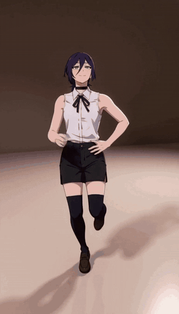
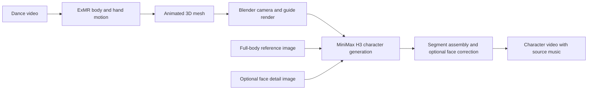

# Free Camera MoCap

**One dance performance. Editable 3D cameras. One generated character.**

Project by Kraizer AI and STEERIX. Includes a generated **768 × 1344 / 24 fps / 29.1 s** Reze result with a dynamic 3D camera, the production pipeline, the H3 workflow, and an offline video player.

## Reze with a dynamic 3D camera — moving preview

The camera moves closer, pulls back, arcs left and right and changes height around the same reconstructed 3D performance; H3 paints the Reze character from that rendered guide. The GIF is a silent, reduced-size preview.

**[Full video](assets/reze-dynamic-camera.mp4) · [Setup and production notes](docs/SETUP.md) · [Dependencies and attribution](docs/DEPENDENCIES.md)**

To play it in a browser, clone or download this repository and open **`index.html`**. The video has no sound.

## What happens to the inputs?

The same recovered motion supports a full camera orbit, close approaches, pullbacks, height changes and roll. The character is generated from the 3D guide that the camera path renders.

The editable asset is the 3D motion scene. **H3 produces 2D character videos**, not a textured, rigged 3D version of the reference character. Generated pose timing, identity, clothing and unseen details can differ from the guide. A single reference picture does not supply a measured back view.

Motion reference label: **아일릿 체포하겠어 댄스 챌린지 영상**. The original source footage and its link are omitted. The video has no sound. Photographs of real people, model weights, credentials and generated job directories are not included. Access to this repository does not grant rights to redistribute the reference material, music or third-party models.

## Repository contents

| Path | Purpose |
| --- | --- |
| `index.html`, `assets/viewer.*` | Offline, muted-autoplay video player |
| `assets/reze-dynamic-camera.mp4` | Generated Reze result with the dynamic camera (768 × 1344, 29.1 s) |
| `pipeline/app.py`, `runner.py`, `full_video.py` | Input validation, managed GPU stages and full-length assembly |
| `pipeline/blender_*.py`, `mesh_export.py` | 3D mesh export and camera rendering |
| `pipeline/h3_prompt.json` | API workflow for H3 with character, face and video references |
| `pipeline/free_camera_explainer.py` | English-captioned explanation movie composition |
| `pipeline/test_*.py`, `verify_*.py` | Existing CPU regressions and production verification scripts |
| `integrations/h3/` | Local ComfyUI controller and model configuration |
| `docs/verification.json` | Redacted production verification summary |

Generation uses a Linux managed-job environment with separately installed ExMR, Blender, ComfyUI/H3, GPU lease service and licensed model assets. It is not a self-contained model installer. See [setup](docs/SETUP.md) before running the pipeline.

Video SHA-256: `7a43f05c76b1d5b5c668e4c54108bcf545c0bdfbbbb4529bf7268a8eb8836937`.

